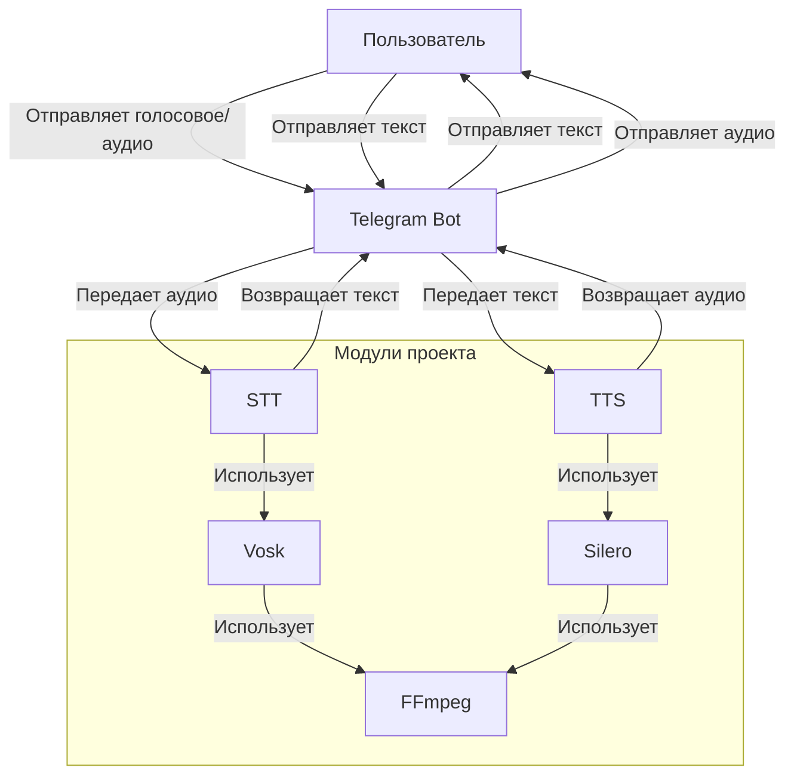
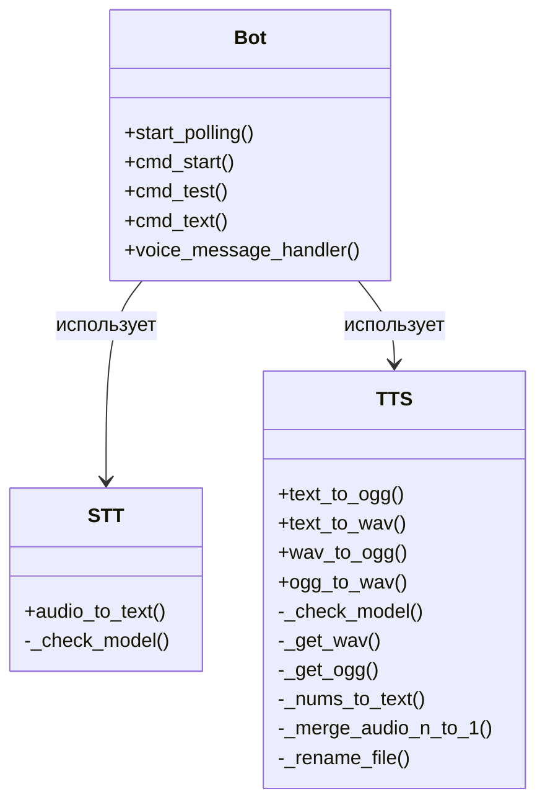
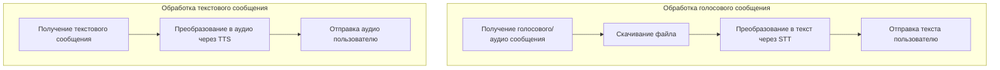

# tg_bot_stt_tts
Telegram bot with voice message recognition and generation. Speech to Text and Text to Speech.

## Структура проекта
```
tg_bot_stt_tts/
├── bot.py               # Основной файл бота
├── stt.py               # Модуль преобразования речи в текст
├── tts.py               # Модуль преобразования текста в речь
├── requirements.txt     # Зависимости проекта
├── .env_example         # Пример файла с переменными окружения
└── models/              # Директория для моделей
    ├── silero/          # Модели для TTS
    │   ├── put ffmpegexe here.txt
    │   └── put modelpt here.txt
    └── vosk/            # Модели для STT
        ├── put ffmpegexe here.txt
        └── put model folder here.txt
```

## Описание файлов

### bot.py
- **Назначение**: Основной файл Telegram-бота, обрабатывающий сообщения и команды.
- **Ключевые функции/классы**:
  - `cmd_start` - Обработчик команд /start и /help
  - `cmd_test` - Обработчик команды /test
  - `cmd_text` - Обработчик текстовых сообщений
  - `voice_message_handler` - Обработчик голосовых и аудио сообщений
- **Связи с другими файлами**: Импортирует классы из stt.py и tts.py
- **Логика**: Инициализирует бота, настраивает обработчики сообщений, преобразует входящие голосовые сообщения в текст и текстовые сообщения в аудио.

### stt.py
- **Назначение**: Модуль для преобразования аудио в текст (Speech to Text).
- **Ключевые функции/классы**:
  - Класс `STT` - Основной класс для распознавания речи
  - `audio_to_text` - Преобразует аудиофайл в текст
  - `_check_model` - Проверяет наличие необходимых моделей и зависимостей
- **Связи с другими файлами**: Используется в bot.py
- **Логика**: Использует модель Vosk для оффлайн-распознавания речи, преобразует различные аудиоформаты в текст с помощью FFmpeg.

### tts.py
- **Назначение**: Модуль для преобразования текста в аудио (Text to Speech).
- **Ключевые функции/классы**:
  - Класс `TTS` - Основной класс для синтеза речи
  - `text_to_ogg` - Преобразует текст в аудиофайл формата ogg
  - `text_to_wav` - Преобразует текст в аудиофайл формата wav
  - `wav_to_ogg`, `ogg_to_wav` - Конвертация между аудиоформатами
  - Вспомогательные методы для обработки текста и аудио
- **Связи с другими файлами**: Используется в bot.py
- **Логика**: Использует модель Silero для синтеза речи, поддерживает разбиение длинных текстов на части и их последующее объединение, конвертирует между форматами с помощью FFmpeg.

## Архитектура проекта

### Общая структура
Проект построен по модульному принципу с четким разделением ответственности:
- `bot.py` - Взаимодействие с пользователем через Telegram API
- `stt.py` - Преобразование речи в текст
- `tts.py` - Преобразование текста в речь

### Потоки данных



### Диаграмма классов



### Процессы обработки сообщений



## Библиотеки/фреймворки

### aiogram
- **Назначение**: Асинхронная библиотека для работы с Telegram Bot API
- **Где используется**: В bot.py для создания бота и обработки сообщений

### torch
- **Назначение**: Фреймворк для машинного обучения
- **Где используется**: В tts.py для работы с моделью Silero

### vosk
- **Назначение**: Библиотека для распознавания речи
- **Где используется**: В stt.py для преобразования аудио в текст

### silero
- **Назначение**: Модель для синтеза речи
- **Где используется**: В tts.py для преобразования текста в аудио

### num2words
- **Назначение**: Библиотека для преобразования чисел в слова
- **Где используется**: В tts.py для обработки текста перед синтезом речи

### ffmpeg
- **Назначение**: Набор библиотек для обработки аудио и видео
- **Где используется**: В stt.py и tts.py для конвертации аудиофайлов

### python-dotenv
- **Назначение**: Библиотека для работы с переменными окружения
- **Где используется**: В bot.py для загрузки токена бота из .env файла

## Точка входа и запуск

### Запуск проекта

Клонируйте репозиторий и перейдите в него в командной строке:

```
git clone https://github.com/QuestGuideRF/tg-bot-voice-to-text.git
cd tg-bot-voice-to-text
```

Cоздайте и активируйте виртуальное окружение:

```
python -m venv venv
. env/Scripts/activate
```

Установите зависимости из файла requirements.txt:

```
python -m pip install --upgrade pip
pip install -r requirements.txt
```

Создайте файл .env и укажите токен вашего бота. Пример есть в .env_example. Процесс создания телеграм бота и получения токена не описан.

Скачайте модели и поместите в необходимые папки. Где взять модели описано ниже.

После скачивания моделей запустите код bot.py в Python.

### Первоначальное выполнение
1. Загружаются переменные окружения из файла .env
2. Инициализируется бот с токеном из переменных окружения
3. Создаются экземпляры классов STT и TTS
4. Регистрируются обработчики сообщений
5. Запускается поллинг для получения обновлений от Telegram API

## Архитектурные особенности

### Нестандартные решения
1. **Модульная структура**: Четкое разделение на модули STT и TTS позволяет легко заменять компоненты
2. **Оффлайн-распознавание и синтез**: Использование локальных моделей Vosk и Silero вместо облачных сервисов
3. **Обработка длинных текстов**: В TTS реализован механизм разбиения длинных текстов на части и их последующего объединения
4. **Преобразование чисел в слова**: Автоматическое преобразование чисел в текстовое представление для корректного синтеза речи

### Причины выбора архитектуры
1. **Приватность**: Локальные модели обеспечивают конфиденциальность данных пользователей
2. **Независимость от интернета**: После загрузки моделей бот может работать без доступа к интернету (кроме API Telegram)
3. **Гибкость**: Модульная структура позволяет легко заменять компоненты или добавлять новые функции
4. **Производительность**: Локальные модели обеспечивают быстрое преобразование без задержек на передачу данных

## Модели Vosk и Silero, а также FFmpeg

*Vosk* - оффлайн-распознавание аудио и получение из него текста. Модели доступны на сайте [проекта](https://alphacephei.com/vosk/models "Vosk - оффлайн-распознавание аудио"). Скачайте модель, разархивируйте и поместите папку model с файлами в папку models/vosk.
- [vosk-model-ru-0.22       - 1.5 Гб](https://alphacephei.com/vosk/models/vosk-model-ru-0.22.zip "Модель vosk-model-ru-0.22 - 1.5 Гб") - лучше распознает, но дольше и весит много.
- [vosk-model-small-ru-0.22 - 45 Мб](https://alphacephei.com/vosk/models/vosk-model-small-ru-0.22.zip "Модель vosk-model-small-ru-0.22 - 45 Мб") - хуже распознает, но быстрее и весит мало.

*Silero* - оффлайн-создание аудио сообщения из текста.
В классе TTS проекта указана [модель Silero v3.1 ru - 60 Мб](https://models.silero.ai/models/tts/ru/v3_1_ru.pt "Модель Silero v3.1 ru - 60 Мб"), которая сама скачается при первом запуске проекта. Остальные модели можно скачать [тут](https://github.com/snakers4/silero-models/blob/master/models.yml "Silero - оффлайн-создание аудио из текста") или на сайте [проекта](https://github.com/snakers4/silero-models "Silero - оффлайн-создание аудио из текста").

*FFmpeg* - набор open-source библиотек для конвертирования аудио- и видео в различных форматах.
Скачайте набор exe файлов с сайта [проекта](https://ffmpeg.org/download.html "FFmpeg - набор open-source библиотек для конвертирования аудио- и видео в различных форматах.") и поместите файл ffmpeg.exe в папки models/vosk и models/silero.

Подпись относится к текущей версии проекта.

---

Автор: legenda  
Telegram: [@LEGENDA_SD](https://t.me/LEGENDA_SD)
